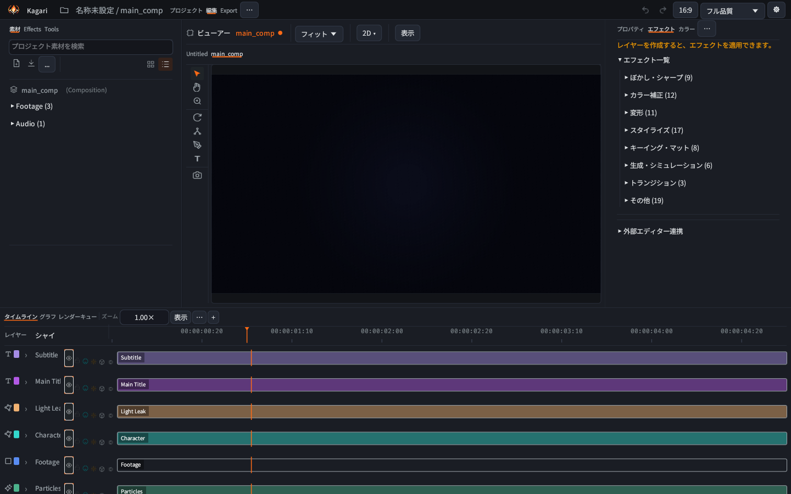
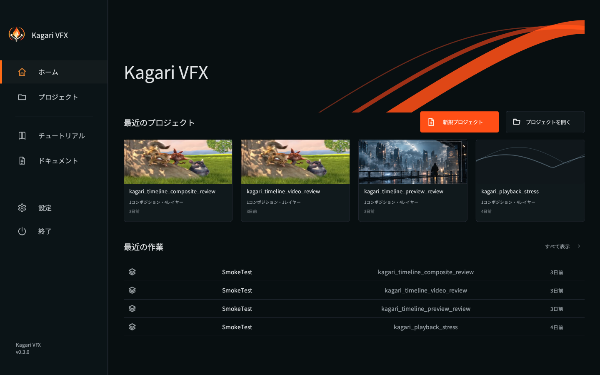

# Kagari VFX

Open-source motion graphics & compositing engine.
Built in Rust with GPU-accelerated preview (Metal on macOS), headless rendering,
and automation-friendly tooling for AI agents.

Kagari is designed to handle the VFX work that code-first video tools eventually outgrow — compositing, effects, tracking, particles, masks, 3D, and more — without requiring a proprietary editor.

---

## Screenshots

| Viewport | Timeline | Home |
| --- | --- | --- |
|  |  |  |

---

## Quick start

```bash
git clone https://github.com/AI-SLOP-BOX/kagari.git
cd kagari
cargo run --release --bin kagari-studio
```

The Studio shell is built with AmeUI. `kagari-studio` is also the package's
default run target.

Headless-only build (no GUI, smaller dependency set):

```bash
cargo build --no-default-features --features cli
```

## CLI

```bash
kagari render --project project.json --comp main --from 120 --to 120 \
  --format png --output ./output
kagari frame --project project.json --frame 120 --output frame.png
kagari effects
kagari lottie --project project.json --output lottie_export.json
```

Sample projects live under `examples/`.

## What it is

Kagari VFX is a **layer-based** compositor and motion graphics engine written in
Rust. A composition is a stack of layers blended bottom-up, with keyframed,
expression-driven properties; a node-graph view visualizes the resulting layer
dependencies. The CLI renders PNG sequences, MP4, and GIF, exports Lottie JSON,
and runs headlessly for scripting or automation. ProRes and MLT are available
through the library export modules; they are not separate CLI subcommands yet.

## Requirements

- **FFmpeg** on `PATH` for video decode and MP4/GIF encode
- A GPU is **optional** — the CPU renderer is the reference implementation and
  runs fully headless. The viewport uses the GPU (wgpu) path when an adapter is
  available and falls back to CPU otherwise.

## Documentation & Architecture

For a comprehensive breakdown of all subsystems, layer types, effect packages, and connected vs in-progress features, see:
- 📖 **[Kagari System Reference & Feature Inventory](docs/KAGARI_SYSTEM_REFERENCE.md)**
- 📐 **[Architecture Guidelines & Robustness Rules](docs/development/ARCHITECTURE_GUIDELINES.md)**
- 📊 **[After Effects Feature Gap Matrix](docs/ae_feature_gap_matrix.md)**

## Stack

- **Rust + wgpu** — GPU compositing with Metal backend on macOS (DirectX 12 / Vulkan on Windows/Linux)
- **AmeUI + Vello** — Native Studio interface and vector rendering
- **FFmpeg** — Video decode / encode pipeline
- **Symphonia + rodio** — Comprehensive multi-format audio decoding & live playback sync
- **Rhai** — Embedded, deterministic expression scripting for animatable properties
- **ab_glyph** — Font glyph layout & rasterization with Text Animator support
- **rayon** — Multi-core parallel CPU effects & Multi-Frame Rendering (MFR)

## License

MIT OR Apache-2.0. Do whatever you want.

